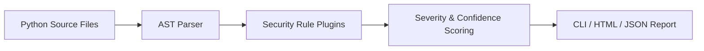

# PyAegis

**PyAegis** is an AST-based Static Application Security Testing (SAST) engine for Python. It inspects source code before deployment and helps teams catch security defects early in the software development lifecycle.

PyAegis parses Python source files into an abstract syntax tree (AST), runs security rule plugins against the resulting nodes, and produces actionable findings with severity and confidence ratings. The result is a fast, extensible scanner that integrates cleanly into local development workflows, CI/CD pipelines, and security audits.

## Overview

Modern applications expose a broad attack surface, and many of the most damaging vulnerabilities originate in application code. PyAegis is designed to detect common **OWASP Top 10** and **CWE** weaknesses before code reaches production.

- **AST-based analysis** — inspects the semantic structure of Python code instead of relying only on text matching.
- **Security-focused rule set** — targets injection flaws, credential exposure, weak cryptography, unsafe deserialization, and related risks.
- **Actionable reporting** — assigns severity and confidence ratings and supports console, JSON, and HTML audit reports.
- **CI-friendly** — exits with a non-zero status when findings are discovered, making it easy to gate deployments.

## Key Capabilities

| Capability | What PyAegis detects |
| --- | --- |
| SQL injection | Hardcoded and dynamically constructed SQL expressions, including common Django ORM misuse. |
| OS command injection | Unsafe use of `subprocess`, `os.system`, shell invocation, and related process APIs. |
| Hardcoded credentials and API keys | Passwords, secrets, tokens, and sensitive values embedded in source code or function defaults. |
| Weak cryptography | Insecure hashes such as MD5/SHA-1, weak cipher modes, and undersized cryptographic keys. |
| Unsafe deserialization | Risky `pickle`, `marshal`, `shelve`, and `yaml.load` usage that can lead to remote code execution. |
| Security audit reports | Exportable HTML and JSON reports suitable for review, archival, and CI artifacts. |

Additional checks cover insecure TLS/SSL configuration, disabled certificate validation, unsafe temporary files, debug mode exposure, template autoescaping issues, and more.

## Architecture



1. **Python Source Files** — files are discovered individually or recursively.
2. **AST Parser** — each file is parsed into Python's abstract syntax tree.
3. **Security Rule Plugins** — plugins evaluate AST nodes against security rules.
4. **Severity & Confidence Scoring** — findings are classified so teams can prioritize remediation.
5. **CLI / HTML / JSON Report** — results are presented in the format best suited to the workflow.

## Installation

PyAegis requires Python 3.10 or newer. Installation from a source checkout uses an editable install so the `pyaegis` command is available immediately.

### Linux / macOS

```console
python3 -m venv .venv
source .venv/bin/activate
python -m pip install --upgrade pip
pip install -e .
```

### Windows (PowerShell)

```powershell
py -m venv .venv
.\.venv\Scripts\Activate.ps1
python -m pip install --upgrade pip
pip install -e .
```

> **Windows note:** If PyYAML fails to build its optional native extension, install PyAegis with libyaml disabled:
>
> ```powershell
> $env:PYYAML_FORCE_LIBYAML = "0"
> pip install -e .
> ```

Verify the installation:

```console
pyaegis --version
pyaegis --help
```

For environments that already depend on the historical command name, the `bandit` entry point remains available as a compatibility alias.

## Quick Start & Usage

Scan a single Python file:

```console
pyaegis app.py
```

Scan a directory recursively:

```console
pyaegis -r ./src
```

Show only medium- and high-severity findings (`-ll` filters to medium and above):

```console
pyaegis -r ./src -ll
```

Generate an HTML security audit report:

```console
pyaegis -r ./src -f html -o audit_report.html
```

Generate a JSON report for automation or downstream processing:

```console
pyaegis -r ./src -f json -o audit_report.json
```

### Common options

| Option | Description |
| --- | --- |
| `-r`, `--recursive` | Recursively scan directories. |
| `-f`, `--format` | Select the report format (`txt`, `json`, `html`, `xml`, `csv`, `sarif`, and others). |
| `-o`, `--output` | Write the report to a file. |
| `-l`, `--level` | Filter by severity (`-l` low, `-ll` medium, `-lll` high). |
| `-i`, `--confidence` | Filter by confidence level. |
| `-c`, `--configfile` | Use a custom configuration file. |
| `--exit-zero` | Exit with status 0 even when findings are present. |

## Integrating with CI/CD

PyAegis returns a non-zero exit status when security issues are found, which allows a pipeline to fail the build and block a deployment. Use `--exit-zero` only when findings should be reported without failing the job.

```yaml
- name: PyAegis security scan
  run: pyaegis -r ./src -f html -o audit_report.html
```

Store `audit_report.html` as a build artifact to keep a security audit trail for each release.

## Attribution

PyAegis builds on the **open-source PyCQA Bandit AST engine**, the foundational static analysis framework for Python security scanning. The internal `bandit` Python package is retained for compatibility with the upstream engine, plugins, formatters, and extension points. We gratefully acknowledge the Bandit maintainers and contributors for their work.

- Upstream project: [PyCQA/Bandit](https://github.com/PyCQA/bandit)
- License: [Apache-2.0](LICENSE)

## License

PyAegis is distributed under the Apache License 2.0. See [LICENSE](LICENSE) for details.
